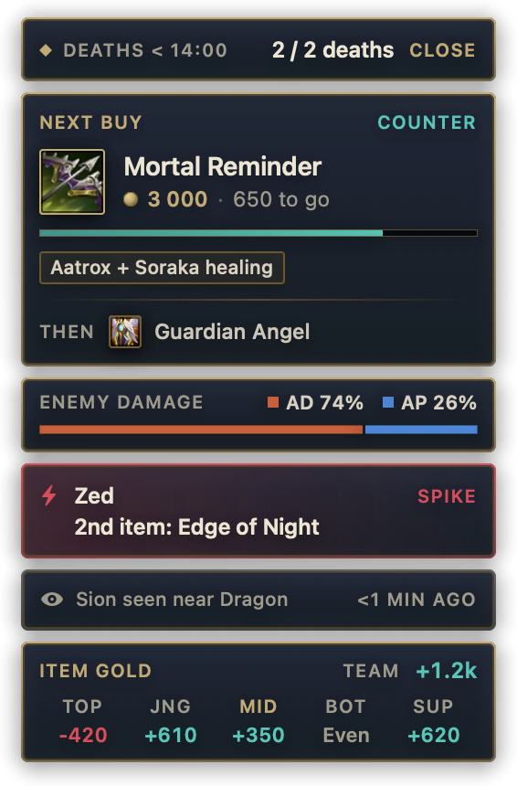

# ganksense

A small macOS menu bar app for League of Legends (Summoner's Rift). It shows useful information during the game and helps you understand your deaths after the game.

<table align="center">
<tr>
<td valign="top"></td>
<td valign="top"></td>
</tr>
</table>

## What it does

- **Counter-builds.** Shows the next item to buy. The advice changes when the enemy team builds new items.
- **One goal per game.** Choose one goal before the game, for example "Deaths before 14:00". The app tracks it live.
- **Death review.** After the game, each death gets a likely cause, for example jungler gank or teamfight. Treat it as a hint, not as a fact.
- **Enemy spike alerts.** A short message when an enemy completes a major item or reaches level 6, 11 or 16.
- **Tilt guard.** A calm reminder after a loss streak or a long session.

The overlay is hidden by default. It appears when something important happens, while you are dead, or while you hold **Tab**.

<table align="center">
<tr>
<td valign="top"></td>
<td valign="top"></td>
</tr>
</table>

## Requirements

- macOS 26 or later, Apple Silicon
- League of Legends in any window mode (Full Screen, Borderless or Windowed)

## Install

```bash
curl -fsSL https://ganksense.app/install.sh | bash
```

The script downloads the app, checks it, puts it in `/Applications` and opens it. Look for the eye icon in the menu bar.

The app is not notarized by Apple yet, so a browser download would be blocked. A `curl` download is not. You can read the script first: [`scripts/install.sh`](scripts/install.sh).

To remove the app:

```bash
curl -fsSL https://ganksense.app/uninstall.sh | bash
```

To also delete your settings and game history:

```bash
curl -fsSL https://ganksense.app/uninstall.sh | bash -s -- --purge
```

## Privacy

ganksense only uses Riot's official local APIs and public static data. It does not read game memory, does not control your keyboard or mouse, and has no accounts and no telemetry.

- **Stored on your Mac only:** your settings and your game history. Other players' names are never stored. Folder: `~/Library/Application Support/ganksense`
- **Network:** public item and champion data from Riot. If you turn it on, build suggestions from OP.GG (sends only the champion, role and game mode).
- **Your control:** Settings > General > Privacy has "Show in Finder" and "Delete all data".

## Permissions

ganksense asks macOS for two optional permissions. The app runs without them.

| Permission | Why | If you refuse |
|---|---|---|
| **Input Monitoring** | To see if Tab is held, so the overlay shows while you hold it. Keys are never recorded. | Holding Tab does not show the overlay. |
| **Screen Recording** | To find which screen the game is on. Only the window position is read, never the screen contents. | The overlay opens on your main screen. |

You can change both in System Settings > Privacy & Security.

## Legal

ganksense isn't endorsed by Riot Games and doesn't reflect the views or opinions of Riot Games or anyone officially involved in producing or managing Riot Games properties. League of Legends and Riot Games are trademarks or registered trademarks of Riot Games, Inc.
