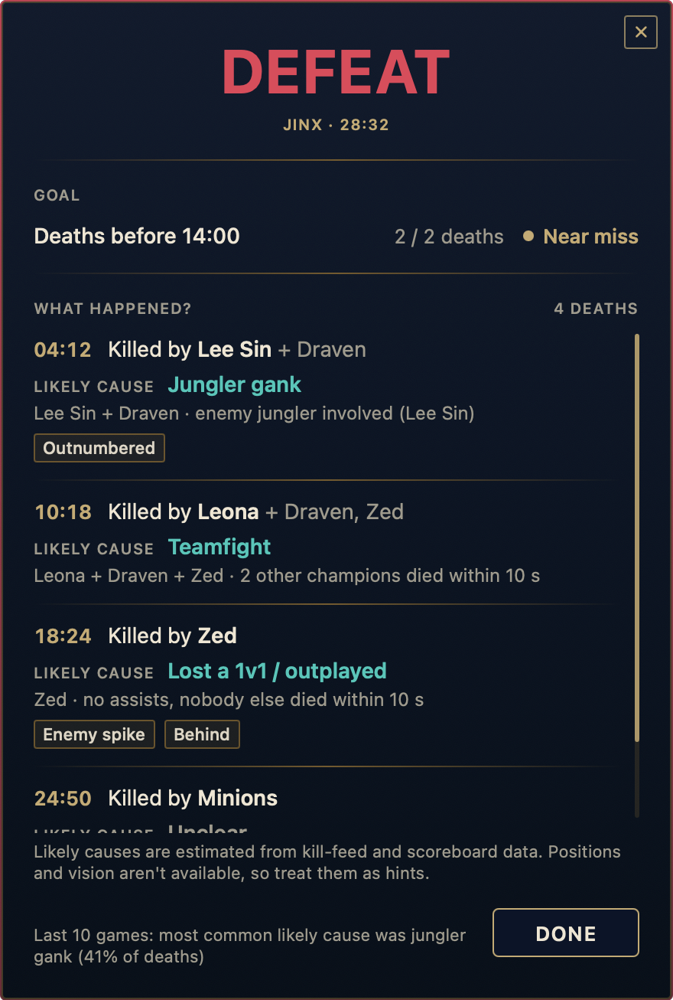
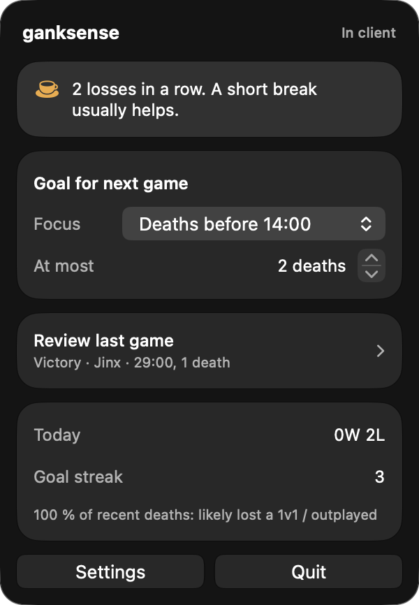
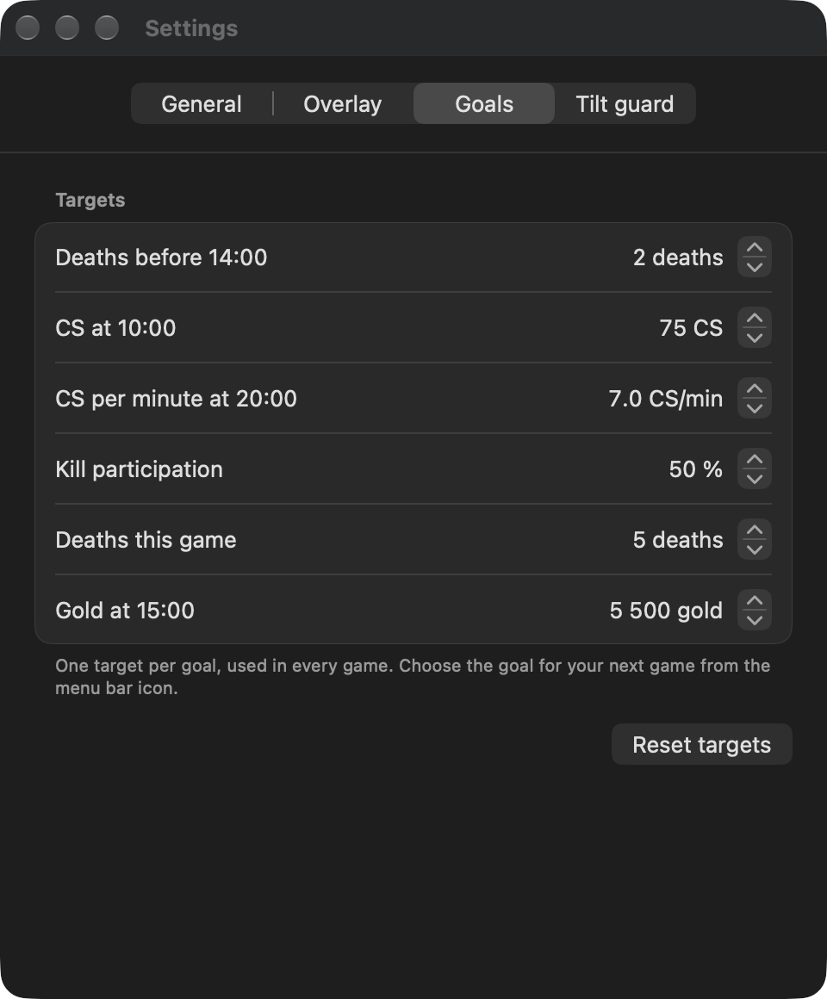

# ganksense

A small macOS menu bar app for League of Legends. It helps from queue to post-game: it scouts the lobby, suggests runes and builds in champ select, shows a quiet overlay during the game and explains your deaths afterwards.

Works in Summoner's Rift games (draft, ranked, blind, quickplay, Clash), the Practice Tool and ARAM. Other modes, such as Arena, are ignored.

<table align="center">
<tr>
<td valign="top"></td>
<td valign="top"></td>
</tr>
</table>

## What it does

**In the queue**

- **Queue clock** in the menu bar while you search for a game.
- **Auto-accept** and a **match found notification**, both optional.

**In champ select**

- **Banner above the client** with the rune page (one click applies it), the core build and summoner spells for your pick.
- **Lane matchup** against your likely opponent, ban ideas, your own record on the champion and into that opponent, and team composition warnings.

**On the loading screen**

- **Scout card** for both teams: rank and season win rate, plus flags such as likely smurf, one-trick, win or loss streak, new on the champion and duo. Ranks come from your local client. A player's champion pool loads from OP.GG only when you open their row.

**During the game**

The overlay is hidden by default. It appears when something important happens, while you are dead, or while you hold **Tab**. It can show:

- **Next item to buy.** The advice changes when the enemy team builds new items.
- **Enemy damage mix** (AD or AP) and **item gold lead** by lane.
- **Spike alerts** when an enemy completes a major item or reaches level 6, 11 or 16.
- **Enemy jungler line**: where the jungler last showed up, from the kill feed and objectives only (never positions).
- **Your goal** with live progress.
- **ARAM augments** in ARAM games.

**After the game**

- **Death review.** Each death gets a likely cause, for example a jungler gank or a teamfight. Treat it as a hint, not as a fact.
- **Your last 10 games.** Patterns across recent games, in the menu bar window.

**Always**

- **One goal per game.** Pick one before the game: deaths before 14:00, CS at 10:00, CS per minute at 20:00, kill participation, deaths this game or gold at 15:00. You can set your own targets.
- **Tilt guard.** A calm break reminder after a loss streak or after a long session.

<table align="center">
<tr>
<td valign="top"></td>
<td valign="top"></td>
</tr>
</table>

Builds come from OP.GG when "Use OP.GG builds" is on (Settings > General). With it off, the app uses its own built-in builds and makes no OP.GG requests. Overlay position, size and the optional lines are in Settings > Overlay.

<p align="center"></p>

## Requirements

- macOS 26 or later, Apple Silicon
- League of Legends in any window mode (Full Screen, Borderless or Windowed)

## Install

```bash
curl -fsSL https://ganksense.app/install.sh | bash
```

The script downloads the app, checks it, puts it in `/Applications` and opens it. Look for the eye icon in the menu bar.

The app is not notarized by Apple yet, so a browser download would be blocked. A `curl` download is not. You can read the script first: [`scripts/install.sh`](scripts/install.sh).

To remove the app:

```bash
curl -fsSL https://ganksense.app/uninstall.sh | bash
```

To also delete your settings and game history:

```bash
curl -fsSL https://ganksense.app/uninstall.sh | bash -s -- --purge
```

## Privacy

ganksense only uses Riot's official local APIs and public static data. It does not read game memory, does not press keys or move the mouse, and has no accounts and no telemetry.

- **Stored on your Mac only:** your settings and your game history (date, champion, role, result, goal result, and each death with its time and killer champion). Other players' names are never stored. Folder: `~/Library/Application Support/ganksense`
- **Riot:** public item and champion data from `ddragon.leagueoflegends.com`.
- **OP.GG** (only with "Use OP.GG builds" on): your champion, role and game mode for builds; the lane opponent for matchup tips; the ARAM augment list. When you open a player's row on the scout card, that player's Riot ID and region are sent once to load their champion pool. Nothing from OP.GG is cached under a player's name.
- **League client:** the app reads your lobby, champ select and match history from the local client. It writes to the client only to accept a match (if auto-accept is on) and to save a rune page when you click apply.
- **Your control:** Settings > General > Privacy has "Show in Finder" and "Delete all data".

## Permissions

ganksense asks macOS for two optional permissions. The app runs without them.

| Permission | Why | If you refuse |
|---|---|---|
| **Input Monitoring** | To check if Tab is held, so the overlay shows while you hold it. Only the Tab key's state is read; keys are never recorded. | Holding Tab does not show the overlay. |
| **Screen Recording** | To find where the game and client windows are, so the overlay and champ select banner line up. Only window positions are read, never the screen contents. | The overlay and banner open on your main screen. |

You can change both in System Settings > Privacy & Security.

## Legal

ganksense isn't endorsed by Riot Games and doesn't reflect the views or opinions of Riot Games or anyone officially involved in producing or managing Riot Games properties. League of Legends and Riot Games are trademarks or registered trademarks of Riot Games, Inc.
