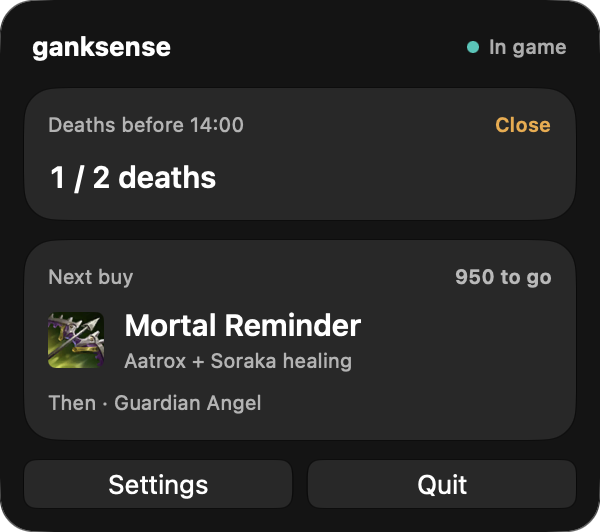

# ganksense

A small macOS menu bar app for League of Legends (Summoner's Rift). It shows useful information during the game and helps you understand your deaths after the game.

<table align="center">
<tr>
<td valign="top"></td>
<td valign="top"></td>
</tr>
</table>

## What it does

- **Counter-builds.** Shows the next item to buy. The advice changes when the enemy team builds new items.
- **One goal per game.** Choose one goal before the game, for example "Deaths before 14:00". The app tracks it live.
- **Death review.** After the game, each death gets a likely cause, for example jungler gank or teamfight. The app uses the kill feed and the scoreboard. It does not know positions or vision, so treat the result as a hint, not as a fact.
- **Enemy spike alerts.** A short message when an enemy completes a major item or reaches level 6, 11 or 16.
- **Tilt guard.** A calm reminder after a loss streak or a long session.

The overlay is hidden by default. It appears for a few seconds when something important happens, while you are dead, or while you hold **Tab**.

<table align="center">
<tr>
<td valign="top"></td>
<td valign="top"></td>
</tr>
</table>

## Requirements

- macOS 26 or later, Apple Silicon
- League of Legends in any window mode (**Full Screen**, **Borderless** or **Windowed**)

## Install

```bash
curl -fsSL https://ganksense.app/install.sh | bash
```

The script downloads the app, checks its SHA-256 checksum, puts it in `/Applications` and opens it. Look for the eye icon in the menu bar.

To remove the app (add `--purge` to also delete your settings and game history):

```bash
curl -fsSL https://ganksense.app/uninstall.sh | bash
```

**Why a script and not a .dmg?** The app is not notarized by Apple yet. macOS blocks files that you download with a browser. Files that you download with `curl` are not blocked. The script is short. You can read it first: [`scripts/install.sh`](scripts/install.sh).

## Privacy

ganksense only uses Riot's official local APIs (Live Client Data and League Client) and public static data. It does not read game memory. It does not control your keyboard or mouse. It has no accounts and no telemetry.

- **Stored on your Mac only:** your settings and your game history. The history has the date, your champion, the result, and each death with its time and the champion names of the killers. Other players' names are never stored.
- **Network requests:** public data from Riot's Data Dragon (item and champion lists, icons). If you turn it on, build suggestions from OP.GG. This request contains only the champion, the role and the game mode.
- **Tab key:** the app checks locally if Tab is held. It does this only during a game with League in front. It does not record keys. You can turn it off in Settings. See Permissions below.
- **Your data, your control:** Settings > General > Privacy has "Show in Finder" and "Delete all data".

Data folder: `~/Library/Application Support/ganksense`

## Permissions

ganksense asks macOS for two optional permissions. Both are for small features. The app runs without them.

| Permission | Why the app needs it | If you refuse |
|---|---|---|
| **Input Monitoring** | To see if the Tab key is held, so the overlay can show while you hold Tab. The app only reads "is Tab down right now". It does not record or store keys. | The overlay still appears for alerts and while you are dead. Holding Tab does not show it. |
| **Screen Recording** | To find which screen the League game window is on, so the overlay opens on that screen. The app reads only the window position and owner name. It never reads screen contents or window titles. | The overlay opens on your main screen. |

The app never needs Accessibility. It does not take screenshots or record your screen. You can change both permissions at any time in System Settings > Privacy & Security.

## Development

Swift 6.2 and SwiftPM. The Command Line Tools are enough. You do not need Xcode.

| Command | What it does |
|---|---|
| `scripts/test.sh` | Run the unit tests |
| `scripts/bundle.sh [debug\|release]` | Build `dist/ganksense.app` |
| `scripts/package.sh` | Make the release zip and the installer |

Debug flags for `dist/ganksense.app/Contents/MacOS/ganksense`:

- `--demo` plays a recorded game through the real interface. You do not need League. Add `--simulate-tab` to fake a Tab hold.
- `--overlay-preview`, `--review-preview [victory|defeat|none]`, `--popover-preview asleep|client|ingame`, `--settings-preview general|overlay|goals|tilt` show one window with sample data.

### Release

1. Increase the version in `Resources/Info.plist`.
2. Run `GANKSENSE_RELEASE_URL=https://github.com/5phc78tgzt-ctrl/ganksense/releases/download/v<version>/ganksense.zip scripts/package.sh`.
3. Upload `dist/ganksense.zip` to that URL. Put `dist/install.sh` and `dist/uninstall.sh` on the website.

## Legal

ganksense isn't endorsed by Riot Games and doesn't reflect the views or opinions of Riot Games or anyone officially involved in producing or managing Riot Games properties. League of Legends and Riot Games are trademarks or registered trademarks of Riot Games, Inc.
